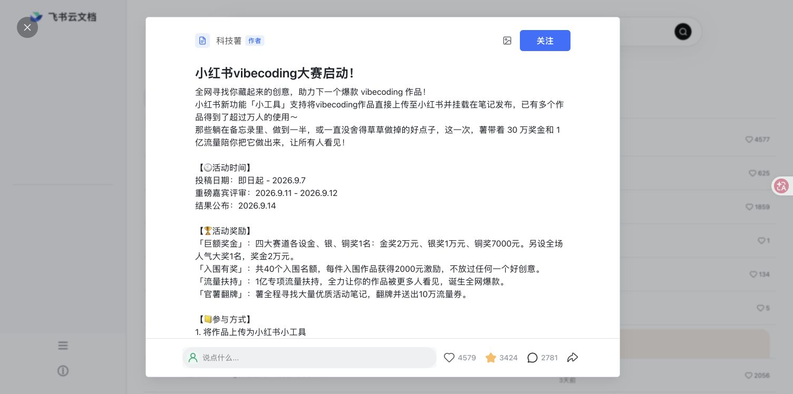

# 小红书 · 飞书云文档外观

一个 Tampermonkey 用户脚本，把小红书网页版换成克制、清晰的飞书云文档风格。默认把图片瀑布流收成云文档式文件列表。

它只修改表现层：小红书原始 DOM、内容、链接、按钮、Vue 事件、登录状态和接口请求均保持不变。

## 界面预览

### 纯文字文档列表（默认）

### 显示缩略图和头像

### 帖子详情（媒体区隐藏）

### 帖子详情（媒体区已展开）

## 安装

1. 安装 [Tampermonkey](https://www.tampermonkey.net/) 或 Violentmonkey。
2. 打开 [`xiaohongshu-lark-docs.user.js`](https://github.com/yangyq081/xiaohongshu-lark-docs/blob/main/xiaohongshu-lark-docs.user.js)，点 **Raw** 后安装。
3. 打开或刷新 <https://www.xiaohongshu.com/explore>。

也可以直接打开 [Raw 安装地址](https://raw.githubusercontent.com/yangyq081/xiaohongshu-lark-docs/main/xiaohongshu-lark-docs.user.js)。脚本安装后会通过同一地址检查更新。

脚本菜单提供：

- 显示缩略图和头像/纯文字文档列表切换（默认纯文字）

如需暂时恢复小红书原始界面，直接通过 Tampermonkey 的脚本开关停用本脚本并刷新页面。

## 覆盖范围

- 顶栏、搜索框、侧栏和频道导航；桌面端显示“飞书云文档”，搜索框进入左栏
- 浏览器标签页使用飞书 Logo；首页标题为“飞书云文档”，详情标题包含原帖标题
- 频道分类默认收起，通过圆点列表图标按钮展开或收起
- 首页和搜索结果改为云文档列表；可选择保留缩略图和作者头像，或使用纯文字列表
- 笔记详情默认使用纯文档模式，媒体区通过作者栏中的图片按钮展开或收起
- 详情评论区和输入区使用居中的飞书文档版式
- 详情真实头像替换为角色图标：作者使用蓝色文档方块，普通评论者使用灰色圆形用户图标
- 评论输入框中的当前用户使用浅绿色圆形用户图标
- 小红书原生按钮、菜单、提示和登录弹窗
- 现有窄屏布局与减少动态效果偏好

## 数据边界

脚本不会：

- 调用或拦截 `fetch`、`XMLHttpRequest`、WebSocket
- 删除、复制、替换小红书内容节点
- 改写任何内容或导航 `href`、表单值或事件处理器
- 自动点赞、关注、评论、发布或登录
- 加载第三方字体、图片、统计或远程脚本

运行时只处理表现和本地播放状态：注入静态 CSS、给 `<html>` 切换主题类、插入频道与详情媒体两个外观按钮、添加专用 favicon、同步标签页标题，并用 Tampermonkey 本地存储保存四个外观选项。详情媒体隐藏时会暂停并静音当前视频，展开后不会自动播放；帖子数据和站点接口不受影响。

## 维护

小红书会不定期调整 CSS 类名。脚本优先使用当前页面较稳定的语义类，例如 `.side-bar`、`.note-item`、`#channel-container`、`#noteContainer` 和 `.reds-button-new`。如果局部样式失效，更新对应 CSS 选择器即可，不需要接触站点数据逻辑。

## License

[MIT](LICENSE) (c) 2026 YAQIYANG

小红书、飞书及 Tampermonkey 的名称、商标与产品归其各自权利人所有。本项目为非官方、非关联作品。
